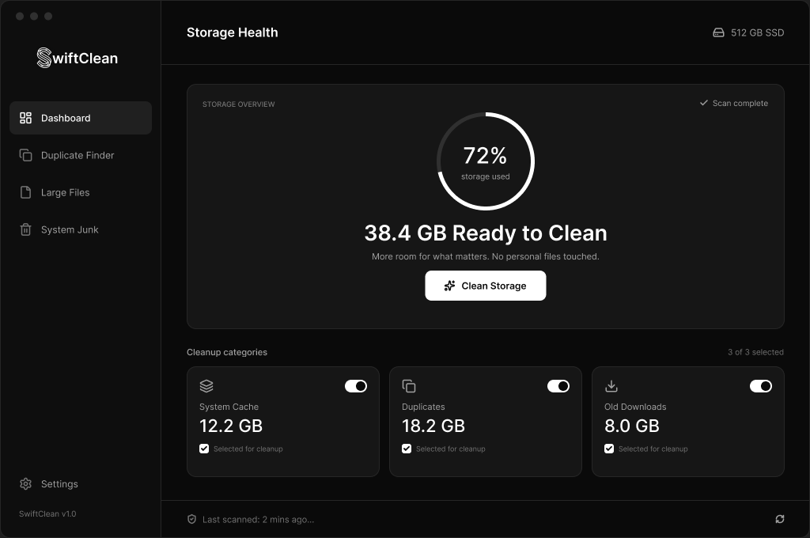

# SwiftClean

**Fast**, **quiet**, and **transparent** storage optimizer. Frees up space without breaking your OS or messing with your personal files.

---

## The Problem

Most disk cleaners are either bloated, ad-ridden, or look like they were built for Windows XP. Built-in OS tools hide stuff behind four submenus and take forever to scan. 

**SwiftClean** was built to fix that: scan your drive, see what's actually taking up space, and wipe out junk in two clicks.

## Preview

## What it actually does

* **System Cache & Junk:** Cleans temp files, build artifacts, system logs, and app caches that drift over time.
* **Duplicate Finder:** Finds byte-for-byte identical files wasting space across directories.
* **Large Files Inspector:** Spots huge files hiding deep in obscure subfolders.
* **Old Downloads:** Flags forgotten installers, zip files, and media sitting in your Downloads folder for months.
* **Zero Magic:** No risky registry "tweaks", no background bloat, no background telemetry. You see exactly what will be deleted before it happens.

## Download & Run

Grab the latest build for your platform on the **[Releases](../../releases)** page. 

Download, run, and clean - no setup wizard gymnastics required.

## Contributing

Got a feature idea, bug fix, or visual tweak? PRs are always welcome.

1. Fork the repo
2. Create your branch (`git checkout -b feature/cool-idea`)
3. Commit changes (`git commit -m 'Add cool feature'`)
4. Push to branch (`git push origin feature/cool-idea`)
5. Open a Pull Request

## License

[MIT](LICENSE) — free to use, modify, and distribute.
